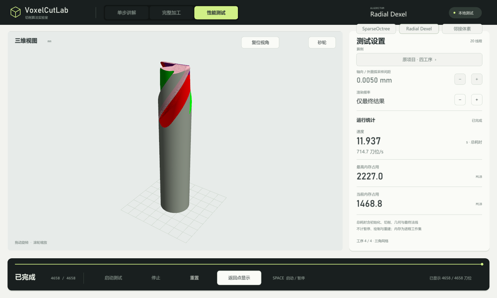
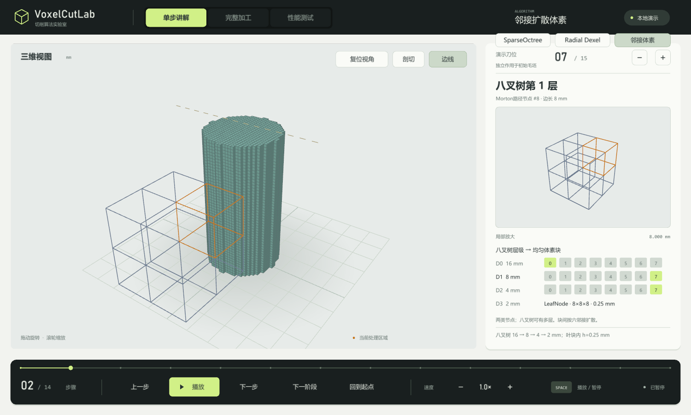
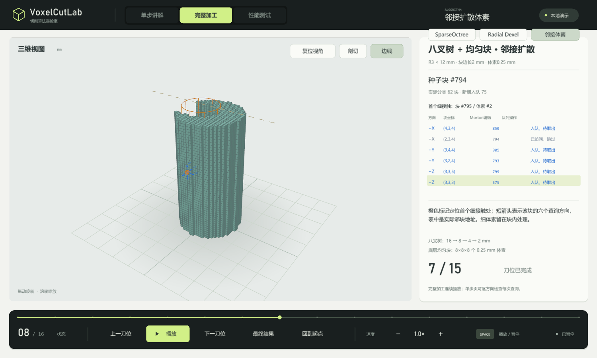
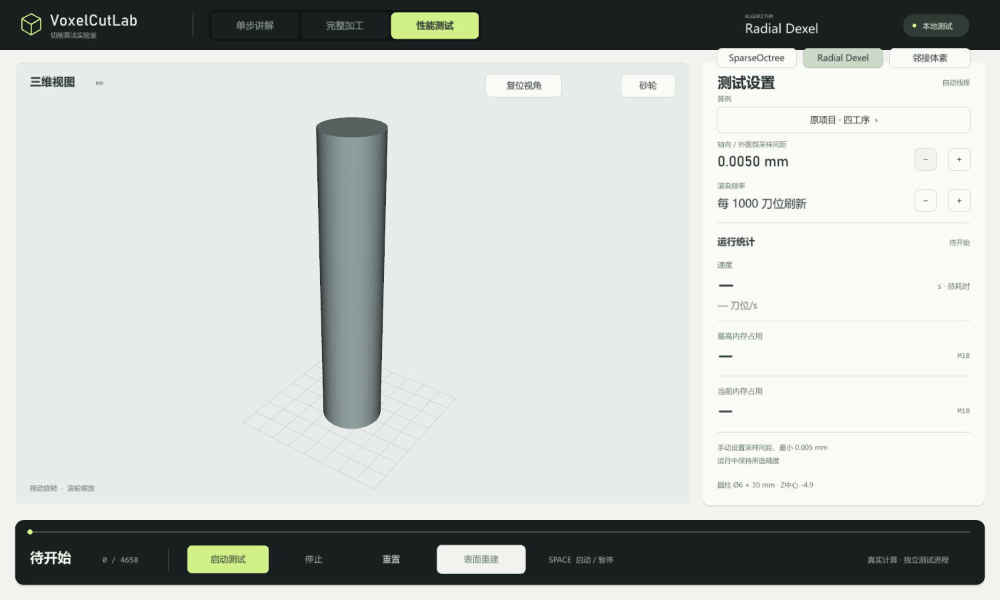

# VoxelCutLab

**把切削过程看清楚，让三种材料表示方法在同一个窗口里运行。**

Windows x64 桌面演示 · 中文交互 · 三维加工 · 算法单步讲解

[下载 Windows 版](https://github.com/yqlzhu910/VoxelCutLab/releases/latest) · [快速上手](docs/QUICKSTART.md) · [功能与操作](docs/USER_GUIDE.md) · [版本说明](CHANGELOG.md)

VoxelCutLab 是一个面向切削与磨削仿真的算法展示程序。你可以逐步观察材料如何被判断和移除，播放完整加工过程，也可以用内置算例运行三种算法，查看耗时和内存统计。

本仓库提供**展示资料与可运行软件**。软件为 Windows 便携版，解压即可使用；本仓库不包含项目源码。

**v0.17 更新：** 新增 SparseOctree 表面重建和包含 62378 个刀位的球头刀加工算例。SparseOctree 与 Radial Dexel 均可查看重建网格；详细变化见 [版本说明](CHANGELOG.md)。

## 下载与启动

1. 打开本仓库右侧的 **Releases**，进入最新发布版本。
2. 在 **Assets** 中下载 **`VoxelCutLab-v0.17-windows-x64.zip`**。
3. 将压缩包**完整解压**到一个可写目录，双击里面的 **`VoxelCutLab.exe`**。
4. 默认进入「单步讲解」。点击底部「播放」，或点击「下一步」开始体验。

请下载上述程序包；GitHub 自动提供的 **Source code (zip / tar.gz)** 只包含本仓库的展示资料。运行所需 DLL、插件和算例已随程序包提供，无需安装 Visual Studio、CMake 或 OSG。请保留解压后的完整目录。

**运行条件：** Windows 10/11 x64、支持 SSE/BMI2 的 x64 处理器，以及支持 OpenGL 3.2 compatibility / GLSL 1.50 的显卡驱动。当前不提供 macOS、Linux 或 Windows ARM 原生版本。

## 三种方式体验

| 页面 | 可以看到什么 | 适合怎样使用 |
|---|---|---|
| **单步讲解** | 毛坯初始化、空间层级、候选区域、材料判断与删除；径向方法还展示表面重建 | 第一次体验，从「下一步」开始 |
| **完整加工** | 15 个教学刀位逐步作用于毛坯，观察最终形状 | 看整体加工过程，旋转模型观察细节 |
| **性能测试** | 完整算例、可调采样间距、刷新间隔，以及耗时和内存统计 | 选择算法与算例，运行一次实际计算 |

三种算法都可在页面右上方切换：

| 算法 | 展示重点 |
|---|---|
| **SparseOctree** | 稀疏八叉树、粗细区域、叶块体素判断与最终表面重建 |
| **Radial Dexel** | 径向材料区间、端点变化与三角网格重建 |
| **邻接扩散体素** | 八叉树和均匀叶块、六方向邻接查询与扩散过程 |

## 看见算法的过程

下方截图来自已有教学与径向演示；v0.17 的新增功能以版本说明和实际程序为准。

### 从空间层级到局部判断

整体视图保留工件位置，右侧局部视图展示当前对象；播放、暂停和进度跳转便于反复观察。

### 跟随刀位，观察材料变化

完整加工页面按教学刀位更新工件，可拖动旋转、滚轮缩放，并使用剖切和边线辅助观察。

### 运行完整算例，查看实际统计

内置原项目四工序、工件 2、文献参数派生螺旋槽和球头刀加工四个算例，分别包含 **4658 / 2502 / 3221 / 62378** 个刀位。SparseOctree 与 Radial Dexel 完成或停止测试后，可在原显示与重建网格之间切换。

截图中的耗时、线程数和内存是对应运行的记录，**不代表跨硬件性能承诺或算法排名**。

## 第一次体验建议

- 先使用「单步讲解」和「完整加工」，熟悉操作后再进入性能测试。
- 首次性能测试可手动选 **0.05 mm** 间距、每 **1000** 刀位刷新。程序默认间距是 **0.005 mm**，更细的采样会增加计算量和内存需求。
- 三种算法的间距含义不同，相同数值不代表相同几何误差；本项目展示采样近似结果。
- 性能测试暂不支持自行导入刀路。文献参数派生算例是项目构造的演示，不是论文 F4 算例的复现。

更多操作、统计口径和常见问题见 [使用说明](docs/USER_GUIDE.md)。

## 技术概览

程序使用 **C++17、MFC、OpenSceneGraph / OpenGL 和 OpenMP**。MFC 承载桌面窗口，OSG 绘制三维模型与界面；性能测试使用独立工作进程运行计算。

第三方组件的来源与许可见 [THIRD_PARTY_NOTICES.md](THIRD_PARTY_NOTICES.md)。项目自身未采用开源许可证；公开展示与可下载运行不表示项目源码已开放。

## 反馈

遇到问题可在本仓库 **Issues** 中提供：软件版本、Windows 版本、CPU / 显卡型号、所选算法和算例、采样间距、复现步骤，以及必要的截图或错误提示。
